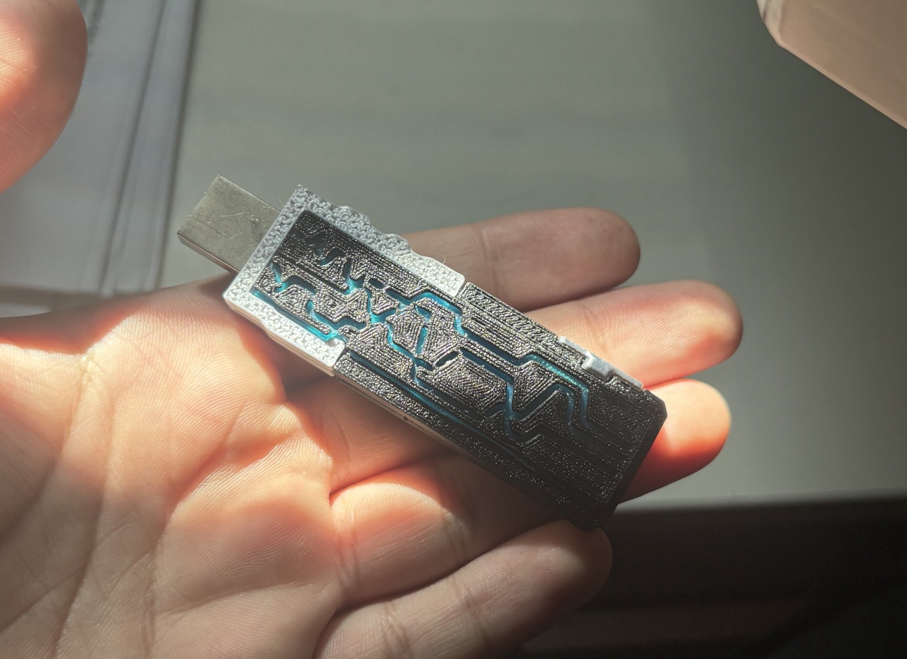
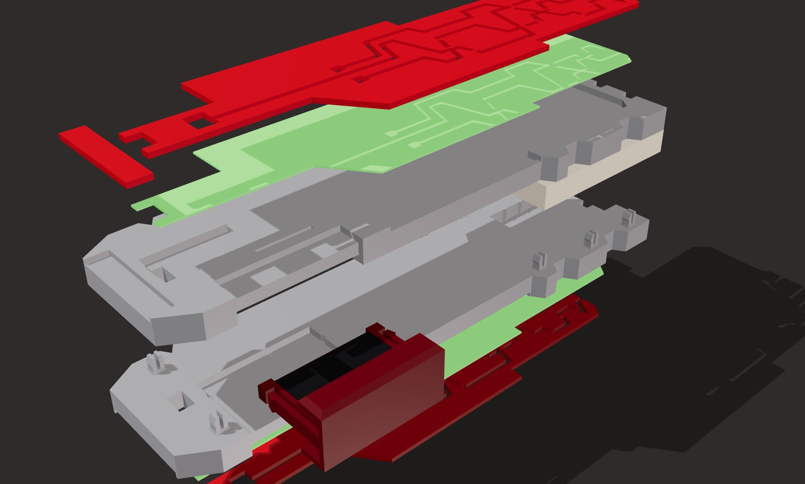
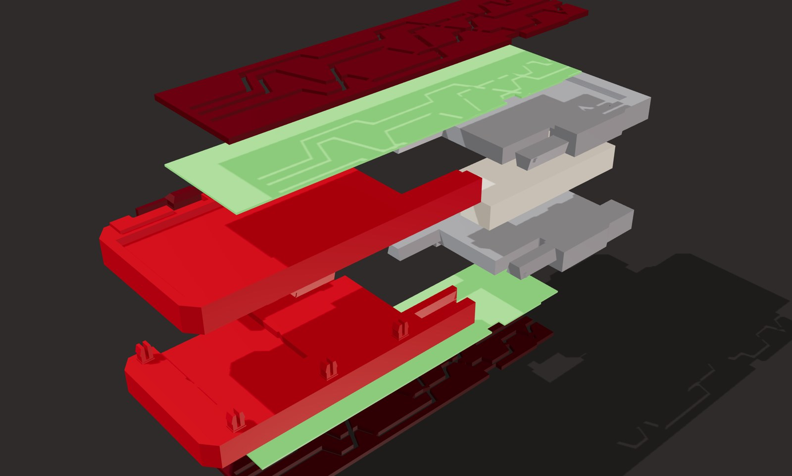
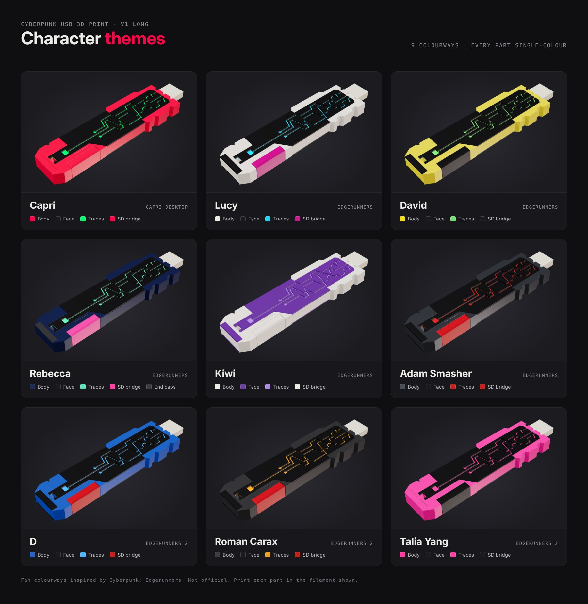

# Cyberpunk USB 3D Print

A 3D-printable, two-sided circuit-trace USB enclosure with a hidden pull-out microSD card holder. I built it as a plug-in starter key for **[Capri Desktop](https://github.com/lachydotmcg/capri-desktop)**: plug it in and Capri starts ([how](#capri-trigger-plug-in-to-start-capri)).



**[Open the interactive 3D viewer →](https://mominmansoor.github.io/cyberpunk-usb-3d-print/)**
In the viewer you can spin the model, pull it apart layer by layer, slide the microSD bridge out and try different colour schemes before you print.

---

## Two versions

| | v1 Long | v2 Short |
|---|---|---|
| Length | 92 mm | 70 mm |
| Width | 26.8 mm (with side ridges) | 24.4 mm |
| Thickness | 8.0 mm | 8.0 mm |
| Body | One piece per half | Rear body and front frame per half, joined by two sliding dovetail rails |
| Printed parts | 8 | 8 |

### v1 Long, opened up


### v2 Short, opened up


The design shows the circuit pattern on both faces, so it looks the same whichever way up it sits.

---

## Character themes

The pictures above are the original colours, but every part prints in a single colour, so you can make it in any colourway you like. Here are nine themes inspired by *Cyberpunk: Edgerunners*, all on the v1 long version:



| Theme | Body | Face | Middle layer (traces) | microSD bridge |
|---|---|---|---|---|
| **Capri** | Crimson pink | Black | Neon green | Crimson pink |
| **Lucy** | White | Black | Cyan | Magenta |
| **David** | Neon yellow | Black | Green | Black |
| **Rebecca** | Navy (charcoal end caps) | Black | Mint | Hot pink |
| **Kiwi** | White | Purple | Lavender | White |
| **Adam Smasher** | Gunmetal | Black | Red | Red |
| **D** | Blue | Black | Ice blue | Red |
| **Roman Carax** | Charcoal | Black | Amber | Red |
| **Talia Yang** | Hot pink | Black | Hot pink | Black |

- Every theme works on v2 too. On v2, "Body" means the front frames and rear bodies.
- The [3D viewer](https://mominmansoor.github.io/cyberpunk-usb-3d-print/) has a colour picker for each part, so you can try your own before printing.
- Each theme is also in [`images/themes/`](images/themes) as a transparent PNG.

These are fan colourways, not official merchandise.

---

## How it works

Every part prints in a single colour. The stick is built in layers, mirrored around the USB drive:

```
face panel  ·  middle layer  ·  body half  ·  USB drive  ·  body half  ·  middle layer  ·  face panel
```

- **Face panels.** The circuit traces are cut right through these, so the middle layer shows through as glowing lines. Each panel prints as one piece. Thin bridges across the traces hold the inner islands in place, so you can peel the panel off the bed and drop it straight in.
- **Middle layer.** This is a thin coloured sheet under each face panel, and it is the colour you see in the traces. You choose the material (see [the middle layer](#the-middle-layer)).
- **Body halves.** The bottom half has built-in snap pins, and the top half clicks onto them. No glue is needed and nothing is loose.
- **v2 sliding joint.** In each half, the silver front frame slides into the rear body on two dovetail rails and clicks home. Closing the halves locks it in place.
- **The microSD bridge.** This is the raised block on the side of the stick. It is really a clip that wraps around the side and pulls out to reveal a tray for a microSD card.
  - Two flexible latch arms click it in place, and it stays put when you shake the stick.
  - Pull it out by the small trapezium bumps on its top and bottom.
  - Slide the card into the tray from the open end. It drops over a small lip and stays there.

---

## Fitting your USB: the public version must be sized to your drive

USB sticks are all different, so this public version has a plain rectangular pocket at the front. By default it fits a standard USB-A plug end or a slim stick:

- **Pocket:** 12 × 4.5 mm, 20 mm deep. 12 mm sticks out of the front, which is enough for a USB-A plug to seat fully.
- **Crush ribs:** small ribs along the pocket sides squash slightly so the drive sits snug.

**Your USB will probably need a different size.** Measure it with calipers, then edit the numbers at the top of [`source/cyberpunk_usb.py`](source/cyberpunk_usb.py):

```python
"public": dict(DRIVE_W=12.0,   # width of your drive
               DRIVE_T=4.5,    # thickness
               DRIVE_L=32.0,   # total length (DRIVE_OUT of it sticks out the front)
               DRIVE_OUT=12.0,
               FIT_W=0.1,      # side clearance per side
               RIB_H=0.25,     # crush-rib height
               LOOP=False, ...)
```

Then run `python3 cyberpunk_usb.py`, which needs `pip install manifold3d shapely trimesh numpy matplotlib`. You get new STLs that fit your drive exactly.

- **Keyring loop:** if your drive has one, set `LOOP=True` and enter the loop opening's size. A peg through the loop then locks the drive in, so it can't pull out when you unplug it.
- **Test first:** print one bottom half and test the fit before printing everything. Printers vary by about 0.1 mm.

---

## The middle layer

The middle layer is a thin flat sheet that sits in a 0.3 mm step under each face panel. You make it yourself from whatever you like. **Glue the face panel down over it**, using a few small dots of glue on the panel's ledges.

| Material | Look |
|---|---|
| **3D printed** | Use the `middle-layer_optional-print-x2` STL and print two. 0.3 mm thick, any filament colour. |
| **Coloured paper** | Bright and matte. Highlighter-coloured paper looks great. |
| **Binder divider or binder cover** | Translucent coloured plastic from a ring binder: cut a strip from a divider or the cover. Put white paper behind it for a brighter colour, or leave it bare and light it from behind with an LED. |

- **Template:** print [`print-files/cyberpunk-usb-3d-print_middle-layer-cut-template.pdf`](print-files/cyberpunk-usb-3d-print_middle-layer-cut-template.pdf) at 100% scale and cut along the outlines. The 50 mm scale bar lets you check the print size.
- **Thickness:** the whole stack must be 0.3 mm or less, so binder plastic plus paper needs a thin binder sheet of about 0.2 mm.
- **Glue tips:** clear flexible glue (E6000 or B-7000) is easiest. With superglue, use the gel kind and very little, because superglue fumes leave a white haze in the trace channels.

---

## Printing

The `print-files` folder has a ready-made **Orca Slicer project** for each version. The projects are set up for a Flashforge Adventurer 5M Pro, and each one opens with one build plate per colour:

| Plate | v1 Long | v2 Short |
|---|---|---|
| 1 | Body halves (silver) | Front frames (silver) |
| 2 | Face panels and end caps (red) | Rear bodies (red) |
| 3 | microSD bridge (dark red) | Face panels and bridge (dark red) |
| 4 | Middle layer, optional (green) | Middle layer, optional (green) |

Open a project with File → Open Project and choose to load it **as a project**. You can change the printer and filament afterwards. Every part is already in its print orientation. The STLs are in `stl/` if you use another slicer, and GitHub shows them in 3D right in the browser.

**Settings I recommend:**
- PLA or PLA+ at 0.2 mm layers and 100% infill.
- **2 wall loops**, with **"Only one wall on top surfaces"** turned on, so the top surface pattern shows on the thin parts. Use the Arachne wall generator.
- Supports only for the bottom body half, the one with the pins. It prints face down, and the project already turns supports on for that part only, with an easy-peel gap.
- Print the microSD bridge in PETG or a tough PLA if you can, because its latch arms flex every time you click it.

---

## Assembly

1. **v2 only:** in each half, slide the front frame's two rails into the rear body until they click.
2. Put your USB drive in the bottom half, with the plug sticking out of the front.
3. Press the top half on until the snap pins click.
4. On each face, lay the middle layer in its step, then glue the face panel over it. On v1, add the end caps.
5. Push the microSD bridge into its slot until both latches click.

---

## Capri trigger: plug in to start Capri

USB drives can't launch programs on their own (Windows removed AutoRun in Windows 7), so the trigger is in two halves, both in [`capri-trigger/`](capri-trigger):

1. **On the USB:** copy [`capri-trigger/usb/capri.key`](capri-trigger/usb/capri.key) to the top folder of the drive inside the stick.
2. **On your computer:** install the small watcher once. It waits for a drive with `capri.key` and starts Capri Desktop when you plug it in. Other USB sticks are ignored.

| System | Install |
|---|---|
| Windows 10/11 | `powershell -ExecutionPolicy Bypass -File capri-trigger\windows\install.ps1` |
| macOS | `bash capri-trigger/macos/install.sh` |
| Linux | `bash capri-trigger/linux/install.sh ~/Capri/Capri` |

No admin rights are needed, and each one has an uninstall script. See [`capri-trigger/README.md`](capri-trigger/README.md) for details. Tip: turn off Capri's own "Start with Windows" switch if you want the USB to be the only thing that starts her.

---

## Credits

- **Designed with the help of Capri.** I designed this with Capri while building the original.
- **CAD rebuild:** after I lost the original files, the parametric model was rebuilt with Claude (Anthropic).
- **Inspiration:** a cool toy a friend of mine made.

## License

[CC BY-NC 4.0](LICENSE). You can print it, remix it and share it with credit, but not sell it.
